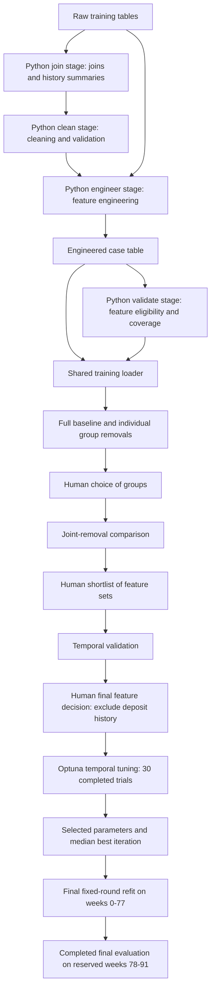

# Credit risk modelling workflow: data processing, feature selection, and tuning

**Checkpoint: 16 November 2026.** Historical study checkpoints retain their dates.

This document explains how the training data was built, how features were
selected, how Optuna tunes LightGBM, and how MLflow records the resulting
experiments and final refit. It includes completed feature-selection results,
the approved 17-feature decision, and the current tuning checkpoint. It is a
personal reference for returning to the project; the README contains the
shorter setup and command guide.

The account below was checked against the notebooks, current Parquet files,
feature inventory, configuration files, Python runners, and local MLflow
records. Numbers in the experiment tables are recorded results, rounded to six
decimal places for readability. Writing this document did not rerun training,
change the datasets, or select a final feature set. The subsequent human decision
on 15 November 2026 is recorded below and in the Optuna configuration. Section
14 preserves the early tuning snapshot; section 20 records the later completed
selection, saved refit, and final test evaluation.

### Reading guide

Read the document in order for the full explanation, or return to a particular
part using these links:

- [Current project state](#1-where-the-project-stands) and
  [the overall processing path](#2-the-overall-path-from-raw-data-to-experiments).
- [Joining the raw tables](#4-notebook-1-joining-and-summarizing-the-training-tables),
  [cleaning](#5-notebook-2-cleaning-and-validating-the-joined-table), and
  [feature engineering](#6-notebook-3-the-15-engineered-features).
- [Eligibility and coverage](#7-notebook-4-deciding-which-columns-may-enter-the-model),
  [time splits](#8-time-splits-and-preparation-for-lightgbm), and
  [evaluation metrics](#10-how-to-read-the-evaluation-metrics).
- Recorded [individual ablation](#11-completed-experiment-1-individual-group-ablation),
  [joint-removal](#12-completed-experiment-2-joint-removal-review), and
  [temporal-validation results](#13-completed-experiment-3-temporal-validation).
- [Optuna tuning and final refit](#14-optuna-hyperparameter-tuning-and-final-refit).
- [MLflow records and provenance](#15-how-mlflow-keeps-the-experiment-record),
  [DVC and pytest](#16-dvc-git-and-pytest-now-support-this-workflow), and
  [practical commands](#17-practical-commands-for-returning-to-the-work).
- [Final test evaluation](#20-final-test-evaluation-of-the-frozen-selected-model).
- [Remaining work](#18-what-remains-to-decide) and
  [the source/run reference](#19-source-map-and-run-identifiers).

## 1. Where the project stands

The project has a case-level training table with **1,526,659 rows and 657
columns**. A row represents one application case identified by `case_id`.
Twenty columns are currently eligible model inputs. The remaining columns have
explicit roles: metadata, target label, excluded raw dates, or features awaiting
review.

We have completed three stages of feature evaluation:

1. An individual group-ablation study: train the full baseline, then retrain
   with each of seven feature groups removed separately.
2. A joint-removal study: evaluate combinations of three groups chosen for
   further investigation, then stop for review.
3. Temporal validation: compare two explicitly chosen reduced feature sets
   with the full baseline over three chronological validation windows.

The latest completed temporal study is `temporal-review-v1`. Its historical status
is `awaiting_human_feature_decision`. On 15 November 2026, the user selected
**`without_deposit_history` as the final feature set: 17 inputs**. The tuning
configuration records that decision and explicitly excludes the three deposit
features. The DVC-tracked inventory still describes the original 20 eligible
inputs used by historical baseline and ablation comparisons.

Optuna study `lightgbm-optuna-v1` completed **30 trials** and selected
`trial-027`, with mean validation Gini stability **0.293412**. Its final refit
uses **422 boosting rounds** and all development weeks 0–77. On 16 November
2026, that saved model was evaluated on weeks 78–91: test AUC **0.660722** and
Gini stability **0.145031** across **151,707 cases**. Section 20 records the
evaluation procedure and results; section 14 preserves the earlier in-progress
checkpoint. The expanded implementation has **49 passing tests**.

The strongest consistency observed among the two reduced sets evaluated was
for removing deposit history alone: its Gini stability improvement was positive
in all three windows. That observation comes with an AUC tradeoff, explained
later. The user's decision selects that configuration; it does not establish
that its AUC improved in every validation window.

Weeks **78–91 were excluded from Python model fitting, feature selection,
and tuning**, then explicitly read by the final evaluator after the model was
fixed. Preprocessing checks and the exploratory split notebook had accessed
the complete dataset; that distinction remains relevant when describing the
scope of the holdout.

## 2. The overall path from raw data to experiments

The supported preprocessing command is now `make preprocess`, implemented by
the four Python stage modules in `data_preprocessing`. The notebooks referenced
below remain unchanged as explanatory records of the same transformations.
Individual stages can be run with `make preprocess-join`, `preprocess-clean`,
`preprocess-engineer`, and `preprocess-validate`. The latter targets expect the
upstream files to exist; training targets do not rebuild preprocessing.



There are two distinct outputs before training:

- `train_base_engineered.parquet` contains the data values, including many
  columns that are not yet used for modelling.
- `model_feature_eligibility.csv` describes each column and tells the training
  code which columns may enter the model.

The inventory therefore acts as the explicit boundary between a wide
preprocessed dataset and the smaller model matrix. Creating or retaining a
column in Parquet does not automatically make it a model input.

The current intermediate and final tables are:

| Output under `dataset/processed/` | Rows | Columns | Meaning |
| --- | ---: | ---: | --- |
| `train_base_depth0.parquet` | 1,526,659 | 224 | Base cases plus the two static feature sources |
| `train_base_depth1.parquet` | 1,526,659 | 264 | Adds summaries of the simpler repeated-history sources |
| `train_base_depth2.parquet` | 1,526,659 | 642 | Adds summaries of the parent/detail history pairs |
| `train_base_cleaned.parquet` | 1,526,659 | 642 | Standardizes and validates the joined table |
| `train_base_engineered.parquet` | 1,526,659 | 657 | Adds 15 engineered features to the cleaned table |

These dimensions were read from the current Parquet metadata. The unchanged row
count across stages is consistent with the intended case-level structure; the
notebooks also check case-key uniqueness at the relevant validation points.

## 3. Understanding the source data and its keys

The raw training files are under `dataset/raw/train/`. They are not all at the
same level of detail:

- `train_base.parquet` supplies the application cases and their core metadata.
- Depth-0 tables provide static case-level attributes.
- Depth-1 tables can have several records for one case: for example, previous
  applications, deposits, or people associated with an application.
- Depth-2 tables provide details associated with a depth-1 record.

In the paired histories, `(case_id, num_group1)` identifies the parent grouping
used to match depth-2 details to depth-1 records. `num_group2` is a further
detail index and is not treated as a numeric predictor to aggregate.

Some logical tables are split across several Parquet files. Those are **row
shards of the same table**, so they must be read together. For example,
`train_static_0_0.parquet` and `train_static_0_1.parquet` are combined before
joining their features to the base cases.

The key practical issue is preventing repeated histories from multiplying
application rows. If one case has three parent records and ten detail rows,
a direct join of all raw records can repeat information and distort both
counts and averages. The processing first summarizes histories at the
appropriate keys, then joins the summaries to the case table.

### The feature-definition helper

The script [feature_definitions_enchancer.py](../EDA/feature_definitions_enchancer.py)
reads training Parquet schemas and adds a `TrainingTables` field to the original
feature-definition CSV. It removes shard suffixes when identifying a logical
table and writes `dataset/raw/feature_definitions_enhanced.csv`.

This is a lookup aid for understanding where a variable appears. It does not
transform the training rows or establish whether a variable was available at
the time a credit decision would have been made.

## 4. Notebook 1: joining and summarizing the training tables

Source: [1_table_joins.ipynb](../data_preprocessing/1_table_joins.ipynb).

### 4.1 Depth-0 joins

The notebook starts from the base cases and left-joins:

- `static_0`, reading its row shards together;
- `static_cb_0`.

Before the joins, it checks that the base and both static tables have one row
per non-null `case_id`. It compares total row count with the number of distinct
case IDs, which also catches null IDs because SQL distinct counts exclude nulls.

A left join retains a base case even when a source table has no matching record.
Unmatched source features are null. Feature names receive a source prefix such
as `static_0_`, while `case_id` and the base metadata retain their original names.
The output is `train_base_depth0.parquet`.

### 4.2 Simpler depth-1 histories

The notebook then summarizes these sources separately by `case_id`:

| Source | Information added |
| --- | --- |
| `debitcard` | Record count and selected amount/date/category summaries |
| `deposit` | Record count and selected amount/date/category summaries |
| `other` | Record count and selected summaries; amount means only |
| `tax_registry_a` | Record count and selected summaries |
| `tax_registry_b` | Record count and selected summaries |
| `tax_registry_c` | Record count and selected summaries |

The aggregation rules in this part of the notebook depend on the variable name:

- Names ending in `A`: mean and maximum amounts, except that `other` keeps only
  the mean because its current training file has at most one record per case.
- Names ending in `D`: earliest and latest dates, after casting to SQL dates.
- Names ending in `M`: the number of distinct recorded category values.
- Every source also gets a record count.

Each resulting summary has at most one row per case. After left-joining the
summaries, missing source record counts become zero. Other unavailable summary
values remain null. The output is `train_base_depth1.parquet`.

A zero record count and a null amount mean different things: the former says
there was no matching source record; the latter says that statistic is
unavailable. The code does not replace every missing feature with zero.

### 4.3 Histories with parent/detail pairs

The more involved part processes depth-1/depth-2 pairs for:

- previous applications (`applprev`);
- credit bureau A (`credit_bureau_a`);
- credit bureau B (`credit_bureau_b`);
- people associated with the case (`person`).

Parent records are summarized independently from detail records. Detail records
are first grouped by `(case_id, num_group1)`, restricted to keys present in the
parent table, and then rolled up to `case_id`.

The general helper applies these rules:

| Field type or naming rule | Summary within a parent/group | Rollup for depth-2 summaries |
| --- | --- | --- |
| Date field ending in `D` | Minimum and maximum dates | Minimum of minima; maximum of maxima |
| Text field | Distinct-value count | Largest distinct count within any parent |
| Boolean field | Share of true values | Mean across parents with a value |
| Other numeric field ending in `T` | Minimum and maximum | Corresponding extrema across parents |
| Other numeric field | Mean and maximum | Mean of parent means; maximum of parent maxima |

The depth-2 means give equal weight to each parent with a recorded mean. They
are not means over every raw detail row. As a simple illustration, if one
parent's detail mean is 100 and another's is 20, the across-parent mean is 60,
even if one parent has many more detail rows.

Similarly, the maximum within-parent distinct count is not the total number of
distinct categories across the entire case. Those summaries answer different
questions, and the output names preserve that distinction.

For `person_1`, the code retains the applicant's values from records with
`num_group1 = 0`, under names such as
`person_1_applicant_mainoccupationinc_384A`. It also counts the people recorded
for the case. The depth-2 person summaries still cover details for all matched
people, not just the applicant.

Additional history fields include the number of parent records, number of
matched detail records, number of parents with details, and maximum detail
records per parent. The main missing parent/detail counts are filled with zero
after the joins; unavailable statistics are left null.

### 4.4 How the large joins are kept manageable

The code uses DuckDB rather than loading all raw history tables into pandas.
For the paired histories, it uses two threads, a 2 GB memory limit, and a
temporary spill directory. It writes intermediate case-level summaries, joins
the cases in eight hash partitions, and combines those partitions into the
final output.

The hash partition is a processing device, not a training/validation split.
The code also permits row reordering, so `case_id` is the reliable identifier;
row position is not a meaningful business key.

Final outputs are staged in temporary locations and moved into place once
writing completes. The paired-history output is `train_base_depth2.parquet`.

## 5. Notebook 2: cleaning and validating the joined table

Source: [2_table_cleaning_post_table_joins.ipynb](../data_preprocessing/2_table_cleaning_post_table_joins.ipynb).

Cleaning starts from the wide, joined depth-2 table. It makes that table
consistent enough for feature engineering without yet deciding that every
column should be used by the model.

### Missingness inspection

The notebook summarizes null counts and percentages using Parquet metadata.
This inspection showed some columns with effectively no coverage, including
five applicant fields with 100% null values in the saved output. The cleaning
stage does not automatically drop columns based on a missingness threshold.

That distinction is useful later: a column can remain available for audit or
future review while being absent from the eligible model inputs.

### Type and value normalization

Text columns representing dates are cast to SQL `DATE`. The detection covers
text fields ending in `D` and `date_decision`; history dates already converted
during aggregation do not need this step again.

The notebook checks floating-point columns for positive or negative infinity.
If infinities are found, it replaces them with nulls. The saved execution found
none.

It also checks text fields for empty or whitespace-only values and would replace
those with nulls. The saved execution found blanks in **0 of 47** remaining text
columns. This check targets blank text; it does not establish that every
possible domain-specific placeholder code has been interpreted.

### Validation before saving

Before replacing the cleaned output, the notebook asserts that:

1. The table is nonempty.
2. Every row has a unique, non-null `case_id`.
3. Every target is present and binary, either 0 or 1.
4. Every row has `WEEK_NUM` and `date_decision`.
5. No infinities or blank text remain after normalization.

The result is `train_base_cleaned.parquet`: 1,526,659 rows and 642 columns.
This stage preserves missing feature values rather than applying a general
imputation scheme. It also does not remove cases simply because some history
sources are missing.

## 6. Notebook 3: the 15 engineered features

Source: [3_feature_engineering.ipynb](../data_preprocessing/3_feature_engineering.ipynb).

The engineered output retains the cleaned source columns and adds three
case-level features plus twelve historical date features. The raw history
tables are read again for the latter, because the event-date cutoff must be
applied before summarizing eligible events.

### 6.1 Affordability ratios

```text
annuity_to_reported_income
    = static_0_annuity_780A / person_1_applicant_mainoccupationinc_384A

credit_amount_to_reported_income
    = static_0_credamount_770A / person_1_applicant_mainoccupationinc_384A
```

A ratio is calculated only when the reported income is finite and strictly
positive, and the numerator is finite and nonnegative. Otherwise the result
is null. This avoids invalid divisions and treats an unavailable ratio
differently from an observed zero ratio.

Both ratios are present for **1,526,650 cases**, leaving nine cases without a
valid ratio. These are ratios against the dataset's reported main income;
the transformation does not establish a new verified income measure or a
complete affordability assessment.

### 6.2 Employment tenure

`employment_tenure_days` is the number of days between
`person_1_applicant_empl_employedfrom_271D` and `date_decision`.

A start date on the decision date gives zero. A missing or future start date
gives null. This feature is available for **566,385 cases**, about **37.1%**
of the table.

### 6.3 Historical event-date features

Four sources each produce three features:

| Prefix | Raw depth-1 source | Date field | Cases with eligible history |
| --- | --- | --- | ---: |
| `debit_card_opening` | `debitcard` | `openingdate_857D` | 105,087, about 6.9% |
| `deposit_opening` | `deposit` | `openingdate_313D` | 105,111, about 6.9% |
| `prior_application` | `applprev` | `creationdate_885D` | 1,207,863, about 79.1% |
| `active_bureau_update` | `credit_bureau_a` | `lastupdate_1112D` | 559,794, about 36.7% |

For every source, a raw event is eligible only if:

```text
event_date < date_decision
```

The cutoff is strict. With only calendar dates, the order of a same-day event
and the credit decision cannot be established, so same-day events are excluded.
This differs from employment tenure, which permits a same-day employment start.

The aggregation then produces:

| Suffix | Meaning |
| --- | --- |
| `_earliest_days_ago` | Days since the oldest eligible event: the largest age |
| `_latest_days_ago` | Days since the newest eligible event: the smallest age |
| `_span_days` | Difference between the oldest and newest eligible event ages |

For example, eligible events 90 and 20 days before a decision produce 90, 20,
and 70. One eligible event produces a zero span. No eligible events produces
nulls for all three fields.

Filtering before aggregation is important. If a case has one event before the
decision and another afterward, the earlier event remains usable. The code
does not discard that earlier event just because the raw history also contains
a future-dated event.

### 6.4 What the date cutoff establishes

The cutoff establishes that the event date precedes the decision date. It does
not, by itself, prove when the information was available to the lender or what
subsequent changes may have been made to a record.

The inventory explicitly retains unresolved availability questions for the
recorded loan terms, their ratios, prior-application history, and bureau-update
history. These features are included for the current experiments with those
qualifications; being eligible is not the same as having passed a complete
scoring-time availability review.

The earlier wide aggregations also are not all independently reconstructed
as point-in-time histories. This is another reason that the hundreds of
unreviewed columns are not automatically offered to the model.

### 6.5 Checks and output

The notebook verifies that feature engineering preserves the input row count
and case-key uniqueness, retains valid labels/time metadata, and creates no
negative or nonfinite non-null engineered values. Null engineered values remain
permitted.

It saves `train_base_engineered.parquet`, containing the original 642 columns
plus the 15 new fields: **657 columns in total**.

## 7. Notebook 4: deciding which columns may enter the model

Source: [4_model_input_validation.ipynb](../data_preprocessing/4_model_input_validation.ipynb).

This notebook writes the feature inventory with four fields:
`column_name`, `data_type`, `role`, and `reason`.

| Role | Count | How it is used |
| --- | ---: | --- |
| `eligible` | 20 | Included in the starting model feature list |
| `review` | 545 | Retained for future definition and availability review |
| `excluded` | 87 | Raw date/timestamp fields retained for audit |
| `metadata` | 4 | Case ID and time fields kept separate from predictors |
| `label` | 1 | The observed `target`, used as the outcome |

The metadata fields are `case_id`, `date_decision`, `WEEK_NUM`, and `MONTH`.
The inventory is a deliberately restricted starting feature set. It is not the
result of training a model on all 657 columns and automatically keeping the
top-ranked variables.

### The 20 eligible inputs and their seven groups

These group definitions are recorded in both feature-selection configurations.
Each eligible input must belong to exactly one group.

| Group | Count | Exact features |
| --- | ---: | --- |
| `applicant_information` | 4 | `person_1_applicant_empl_industry_691L`; `person_1_applicant_incometype_1044T`; `person_1_applicant_mainoccupationinc_384A`; `employment_tenure_days` |
| `loan_amounts` | 2 | `static_0_annuity_780A`; `static_0_credamount_770A` |
| `affordability_ratios` | 2 | `annuity_to_reported_income`; `credit_amount_to_reported_income` |
| `debit_card_history` | 3 | `debit_card_opening_earliest_days_ago`; `debit_card_opening_latest_days_ago`; `debit_card_opening_span_days` |
| `deposit_history` | 3 | `deposit_opening_earliest_days_ago`; `deposit_opening_latest_days_ago`; `deposit_opening_span_days` |
| `previous_application_history` | 3 | `prior_application_earliest_days_ago`; `prior_application_latest_days_ago`; `prior_application_span_days` |
| `bureau_update_history` | 3 | `active_bureau_update_earliest_days_ago`; `active_bureau_update_latest_days_ago`; `active_bureau_update_span_days` |

The names in the group configuration are logical labels. For example,
`previous_application_history` contains features prefixed `prior_application`;
these refer to the same group of inputs.

### Coverage across time

Coverage is the percentage of cases with a non-null feature value. A recorded
zero counts as present. Coverage is not a measure of predictive usefulness,
and a missing history value is not necessarily evidence that a person has no
such history outside the recorded source.

The notebook calculates coverage by `WEEK_NUM`, then reports each feature's
minimum and maximum weekly coverage and the number of entirely empty weeks.
Selected recorded ranges are:

| Feature or family | Minimum weekly coverage | Maximum weekly coverage |
| --- | ---: | ---: |
| Applicant employment industry | 1.13% | 46.63% |
| Employment tenure | 4.65% | 46.90% |
| Debit-card opening features | 4.39% | 9.59% |
| Deposit opening features | 4.43% | 9.68% |
| Prior-application features | 70.94% | 88.51% |
| Bureau-update features | 3.06% | 68.54% |
| Affordability ratios | Approximately 99.99% | 100.00% |

None of the 20 eligible inputs had a completely empty week in the recorded
coverage summary. Nevertheless, some have substantial coverage changes over
time. That is a reason to inspect temporal behaviour rather than interpreting
one overall score as sufficient evidence of stability.

The saved output is `model_feature_eligibility.csv`. Changing the outcome of
feature selection does not automatically rewrite this file.

## 8. Time splits and preparation for LightGBM

The exploratory [5_feature_selection.ipynb](../feature_selection/5_feature_selection.ipynb)
introduced chronological splitting and category preparation. Its split is
approximately 70%/15%/15% **of observed weeks**, not of rows. For the current 92
weeks, this yields:

| Split | Weeks, inclusive | Number of weeks | Cases |
| --- | --- | ---: | ---: |
| Training | 0–63 | 64 | 1,282,082 |
| Validation | 64–77 | 14 | 92,870 |
| Reserved local test | 78–91 | 14 | 151,707 |

The row proportions differ from the week proportions because cases are not
distributed uniformly across weeks. Keeping a whole week in one split avoids
mixing applications from that week across the training/validation boundary.

The executable Python runners now use **fixed boundaries from JSON**, rather
than recalculating percentages for every run. If new data extends the observed
week range, the configuration must be deliberately revised; the current loader
rejects weeks outside the configured bounds.

### Categorical inputs

Two eligible inputs are text categories:

- `person_1_applicant_empl_industry_691L`;
- `person_1_applicant_incometype_1044T`.

They are converted to pandas categorical columns for native LightGBM handling.
The categories are learned on training rows, then the same vocabulary is
applied to validation rows. Values unseen in training become missing rather
than introducing validation-derived category levels. The exploratory full
training split recorded 24 industry categories and 9 income-type categories.

Each earlier temporal training window learns its own categories again from
its own training rows. It does not borrow the vocabulary from weeks 0–63.

### The notebook and runner have different test-data access

Notebook 5 materializes training, validation, and test matrices, including test
labels, and prepares test categories. The Python training loader takes a
stricter approach: it queries the week metadata for split validation but only
materializes training and validation features/labels.

The training and tuning runners keep final weeks out of their fits and
validation. The separate final evaluator reads those rows only after the
model is selected. It would be inaccurate to describe the entire exploratory
project as having never loaded the last weeks' labels. The final-test
performance recorded in section 20 belongs to the frozen saved refit.

## 9. The shared baseline training procedure

Source: [train_baseline.py](../feature_selection/train_baseline.py).

All baseline, ablation, and temporal fits use the shared training logic. It
reads the eligible columns in inventory order and checks that the list is
nonempty, distinct, and separate from metadata and target.

The current explicit model settings are:

| Setting | Value | Purpose |
| --- | --- | --- |
| Model | LightGBM binary classifier | Predict default probabilities |
| `objective` | `binary` | Binary-outcome training |
| `metric` | `auc` | Validation metric used for early stopping |
| `n_estimators` | 400 | Maximum boosting iterations |
| `learning_rate` | 0.05 | Boosting step size |
| `num_leaves` | 31 | Tree complexity setting |
| `random_state` | 42 | Shared random seed |
| `deterministic` | `true` | Request deterministic fitting |
| `force_col_wise` | `true` | Shared LightGBM processing mode |
| Early-stopping patience | 40 | Stop after 40 rounds without sufficient AUC improvement |
| Default threads | 2 | Shared resource setting via Make |

These are a controlled comparison setup, not the result of a completed
hyperparameter search. Other LightGBM settings retain their library defaults;
the full resolved parameter set and package versions are logged per run.

The models use the same rows, column ordering, seed, model configuration, and
early-stopping rule within a comparison. They can still stop at different best
iterations because their feature sets differ. The saved model corresponds to
the fit used for validation; feature ablation retrains a model after removing
columns rather than merely masking the inputs to an already fitted model.

No general scaling, one-hot encoding, or blanket numeric imputation is added
by the shared training loader. The explicit category preparation described
above is the main learned input preparation at this stage.

## 10. How to read the evaluation metrics

The scripts record several measures because one number does not capture every
aspect of temporal performance:

| Metric | Interpretation in this workflow |
| --- | --- |
| Overall validation ROC AUC | Ranking discrimination across the complete validation block; higher is better |
| Average precision | Precision/recall ranking summary for the positive outcome; higher is better |
| Log loss | Quality of predicted probabilities against binary outcomes; lower is better |
| Weekly AUC and Gini | Discrimination for each week, allowing changes through time to be inspected |
| Gini stability | A score combining mean weekly discrimination with trend and variability penalties; higher is better |

These are evaluation summaries for the current experiments. We have not
completed an operational threshold choice, probability-calibration study, or
business-cost evaluation as part of this feature-selection workflow.

### The implemented Gini stability formula

For each scored week:

```text
weekly_gini = 2 * weekly_auc - 1
```

The code fits a straight line to weekly Gini against week number, then calculates:

```text
gini_stability
    = mean_weekly_gini
      + 88 * min(0, weekly_gini_slope)
      - 0.5 * weekly_gini_residual_std
```

The residual standard deviation is measured around that fitted line, using the
population standard deviation (`ddof=0`). A negative slope incurs a penalty.
A positive slope gets no direct slope bonus. Variation around the trend also
reduces the score.

Weekly means here give equal weight to scored weeks. Overall validation AUC is
calculated across all validation cases. They are different aggregations, so a
model can improve stability while slightly reducing overall AUC.

Weeks with only one outcome class have no defined weekly AUC/Gini. The weekly
table retains them, but the stability calculation excludes them and requires
at least two weeks with both classes. The number of scored/skipped weeks is
also logged.

### Deltas and weekly win counts

In the comparison tables:

```text
delta = candidate score - full-baseline score
```

A positive AUC or stability delta means that the feature removal improved that
metric. Weekly wins count the weeks where the candidate's Gini exceeds the
baseline's, using weeks scored by both. Wins are not weighted by case count
or by how large the improvement is.

Early stopping uses **AUC**, while tables are primarily ordered by **Gini
stability**. The workflow does not explicitly optimize the stability formula
at every boosting round, and table order is not an automatic feature decision.

## 11. Completed experiment 1: individual group ablation

Source: [select_features.py](../feature_selection/select_features.py), using
[group_ablation.json](../feature_selection/configs/group_ablation.json).

Recorded study: `group-ablation-first-pass`, started **13 November 2026**.
Parent run ID: `2d0612b83a114bf6aa621b6a87f93421`.

This study trained eight models on weeks 0–63 and evaluated each on weeks
64–77: the full 20-feature baseline plus one removal for each of the seven
groups. Removing applicant information leaves 16 inputs; removing either
two-feature group leaves 18; removing a three-feature history group leaves 17.

The code rejects overlapping groups, unassigned eligible inputs, ineligible
group members, duplicate exclusions, and plans without exactly one full
baseline. This prevents a changed inventory from silently changing the meaning
of a named study.

### Recorded screening results

| Removed group | Inputs | Best iteration | Validation AUC | AUC delta | Gini stability | Stability delta | Weeks better / compared |
| --- | ---: | ---: | ---: | ---: | ---: | ---: | --- |
| None: full baseline | 20 | 137 | 0.665144 | 0.000000 | 0.282450 | 0.000000 | 0 / 14 |
| `deposit_history` | 17 | 98 | 0.665007 | -0.000136 | 0.285116 | +0.002666 | 6 / 14 |
| `affordability_ratios` | 18 | 84 | 0.664163 | -0.000980 | 0.283931 | +0.001481 | 7 / 14 |
| `debit_card_history` | 17 | 104 | 0.663533 | -0.001611 | 0.281843 | -0.000607 | 4 / 14 |
| `bureau_update_history` | 17 | 143 | 0.663457 | -0.001687 | 0.276183 | -0.006267 | 6 / 14 |
| `loan_amounts` | 18 | 49 | 0.659024 | -0.006119 | 0.273442 | -0.009008 | 4 / 14 |
| `previous_application_history` | 17 | 100 | 0.642269 | -0.022875 | 0.233910 | -0.048540 | 1 / 14 |
| `applicant_information` | 16 | 164 | 0.629732 | -0.035412 | 0.221947 | -0.060503 | 1 / 14 |

Source artifact: `ablation_comparison.json` in the screening parent run.

### What the screening showed

Removing deposit history or affordability ratios improved the stability score
on this validation block, although both slightly reduced overall AUC. Removing
applicant information or previous-application history caused much larger
declines under the current model settings.

These measurements describe each group's contribution **conditional on the
other retained groups**. For example, removing the raw loan-amount group still
leaves ratios that contain the loan amounts. It does not remove every trace of
that information from the model.

Ablation also is not a causal explanation of credit risk. It asks how the
retrained predictor performs without a group under this particular setup.
The study records a `best_observed_configuration` for inspection, but does not
change the feature inventory or establish statistical significance.

## 12. Completed experiment 2: joint-removal review

Source: [confirm_features.py](../feature_selection/confirm_features.py), using
[joint_confirmation.json](../feature_selection/configs/joint_confirmation.json).

Recorded review: `joint-review-v1`, started **14 November 2026 at 19:33 London
time**. Parent run ID: `338b363debf84e4bb312dfe420b40a38`.

The recorded human-chosen groups were:

- `deposit_history`;
- `affordability_ratios`;
- `debit_card_history`.

This choice was recorded as coming from the command line. It is not an
automatically generated top-three list. In particular, the debit-card group's
individual removal had a slightly negative stability delta, but its joint
removal with other groups was still investigated.

### What was fitted and what was reused

With three chosen groups, the runner generates the three pairs and the triple
removal, and fits those four combinations plus a fresh full baseline. It reuses
the three relevant individual-removal models from screening.

That produces eight removal patterns in the review table: one baseline, three
singles, three pairs, and one triple. The nested fitted study is `joint_removals`,
run ID `3760794c3806452491e4e02f4a3cd3e3`.

For `k` chosen groups, there are `2^k - 1 - k` removals involving at least two
groups. The number grows quickly, which is why group choice is explicit.

### Recorded joint comparison

The names below describe removed groups, not retained groups.

| Removed groups | Inputs | Validation AUC | AUC delta | Gini stability | Stability delta |
| --- | ---: | ---: | ---: | ---: | ---: |
| None: full baseline | 20 | 0.665144 | 0.000000 | 0.282450 | 0.000000 |
| Deposit | 17 | 0.665007 | -0.000136 | 0.285116 | +0.002666 |
| Ratios | 18 | 0.664163 | -0.000980 | 0.283931 | +0.001481 |
| Debit card | 17 | 0.663533 | -0.001611 | 0.281843 | -0.000607 |
| Ratios + debit card | 15 | 0.664248 | -0.000896 | 0.283846 | +0.001396 |
| Ratios + deposit | 15 | 0.664848 | -0.000296 | 0.281708 | -0.000742 |
| Debit card + deposit | 14 | 0.666125 | +0.000981 | 0.287219 | +0.004770 |
| Ratios + debit card + deposit | 12 | 0.665565 | +0.000421 | 0.283956 | +0.001506 |

Source artifact: `combination_comparison.json` in the review parent run.

The debit-card-plus-deposit removal had the highest observed stability score
in this table and slightly improved AUC. However, the ratios-plus-deposit
combination was worse on stability even though both individual removals were
positive. The effects of removing groups are therefore not additive.

The joint phase stopped with `awaiting_human_shortlist`. It did not start
temporal fits or automatically select the first two rows.

### Exact configuration names

Combined names use sorted group names joined with `__and__`. For example:

```text
without_debit_card_history__and__deposit_history
without_affordability_ratios__and__debit_card_history__and__deposit_history
```

For group choices, the CLI accepts `deposit_history` or
`without_deposit_history`. For configuration choices, it accepts the recorded
name or its version without the initial `without_`. Supplying both aliases for
the same choice is rejected as a duplicate.

## 13. Completed experiment 3: temporal validation

Recorded study: `temporal-review-v1`, started **14 November 2026 at 20:04 London
time**. Parent run ID: `f2a06005d5334643880c86bf36f1afd8`.

The study's selection artifact records these two explicit choices from the
joint review:

1. `without_debit_card_history__and__deposit_history`: 14 inputs.
2. `without_deposit_history`: 17 inputs.

The full `all_eligible` baseline, with 20 inputs, was added as the control. The
reviewed study ID was `338b363debf84e4bb312dfe420b40a38`. Selection was recorded
as human, supplied through the command line.

### The three windows

| Window | Training weeks | Validation weeks | Training cases | Validation cases |
| --- | --- | --- | ---: | ---: |
| `weeks_36_49` | 0–35 | 36–49 | 665,266 | 338,491 |
| `weeks_50_63` | 0–49 | 50–63 | 1,003,757 | 278,325 |
| `weeks_64_77` | 0–63 | 64–77 | 1,282,082 | 92,870 |

All week boundaries are inclusive. Weeks 78–91 remain the final reserved test
block in every window. For an earlier window, weeks after validation and before
week 78 are marked `unused_future` and excluded from that window's model data.

The first two windows each fit a new baseline and the two reduced models: six
fresh fits in total. The latest window reuses the already fitted, compatible
models from screening/joint review rather than training duplicates.

Every reduced model is compared with the baseline trained for **its own
window**. Comparing an early reduced model with the latest baseline would mix
different training histories and validation difficulties.

### Results by window

In this table, “Deposit” means removing only deposit history; “Debit + deposit”
means removing both history groups.

| Validation weeks | Removed groups | Inputs | AUC | AUC delta | Gini stability | Stability delta |
| --- | --- | ---: | ---: | ---: | ---: | ---: |
| 36–49 | None: full baseline | 20 | 0.648639 | 0.000000 | 0.273843 | 0.000000 |
| 36–49 | Deposit | 17 | 0.648847 | +0.000208 | 0.282676 | +0.008832 |
| 36–49 | Debit + deposit | 14 | 0.647846 | -0.000793 | 0.282688 | +0.008844 |
| 50–63 | None: full baseline | 20 | 0.663635 | 0.000000 | 0.299975 | 0.000000 |
| 50–63 | Deposit | 17 | 0.662712 | -0.000923 | 0.308884 | +0.008910 |
| 50–63 | Debit + deposit | 14 | 0.661757 | -0.001878 | 0.279171 | -0.020803 |
| 64–77 | None: full baseline | 20 | 0.665144 | 0.000000 | 0.282450 | 0.000000 |
| 64–77 | Deposit | 17 | 0.665007 | -0.000136 | 0.285116 | +0.002666 |
| 64–77 | Debit + deposit | 14 | 0.666125 | +0.000981 | 0.287219 | +0.004770 |

Source artifact: `confirmation_by_window.json` in the temporal parent run.

### Summary of paired changes

| Removed groups | Inputs | Mean stability delta | Worst stability delta | Mean AUC delta | Windows with higher stability |
| --- | ---: | ---: | ---: | ---: | --- |
| None: full baseline | 20 | 0.000000 | 0.000000 | 0.000000 | Reference |
| Deposit | 17 | +0.006803 | +0.002666 | -0.000284 | 3 / 3 |
| Debit + deposit | 14 | -0.002396 | -0.020803 | -0.000563 | 2 / 3 |

Source artifact: `confirmation_summary.json`. The mean gives each window equal
weight; it is not weighted by the differing numbers of validation cases. The
worst delta is the smallest candidate-minus-baseline delta across windows.

### What these results establish, and what they leave open

The deposit-only removal had positive measured stability deltas in all three
windows. Its overall AUC increased in the earliest window and decreased in the
other two. It is therefore more consistent on the implemented stability
criterion than on overall AUC.

The 14-input debit-plus-deposit removal looked strongest in the latest joint
comparison, but had a sizeable negative stability delta in weeks 50–63. Its
latest-window improvement did not carry consistently across time.

Weekly wins tell a different story again. The deposit-only removal improved
weekly Gini in just **1 of 14 weeks** during weeks 50–63, despite improving the
stability score for that block. The formula rewards a combination of mean,
trend, and residual variation; “higher stability” does not mean “higher AUC
every week.”

For a concrete latest-window example, removing deposit history reduced mean
weekly Gini slightly, from about 0.318808 to 0.318648, but reduced the residual
standard deviation from about 0.072717 to 0.067065. Both fitted slopes were
positive, so neither incurred the negative-slope penalty. The lower variation
more than offset the small reduction in mean weekly Gini in the stability
formula.

These are retrospective validation checks. The latest window already helped
screen and shortlist the candidates, so reusing it is not a new independent
holdout assessment. The training windows also overlap. The workflow does not
calculate confidence intervals or a formal significance test for the changes.

The recorded historical stopping point is **`awaiting_human_feature_decision`**.
The later human decision on 15 November 2026 selects the 17-input deposit-only
removal for tuning. That decision is stored in the tuning configuration;
the historical temporal run and its measurements are unchanged.

## 14. Optuna hyperparameter tuning and final refit

Sources: [tuning runner](../hyperparameter_tuning/tune.py) and
[tuning configuration](../hyperparameter_tuning/configs/lightgbm.json).
Optuna 5.0.0 is included in the Poetry lock file. This stage optimizes model
settings after the human feature decision.

### The fixed feature set

All trials use the same **17 features**: the original inventory's eligible
inputs, in their recorded order, excluding:

- `deposit_opening_earliest_days_ago`;
- `deposit_opening_latest_days_ago`;
- `deposit_opening_span_days`.

`feature_selection` in the tuning configuration records the human choice,
decision date, expected input count, and source temporal run
`f2a06005d5334643880c86bf36f1afd8`. The runner rejects unknown or repeated
exclusions and a feature count that differs from the decision. DuckDB reads
only the selected inputs and required week/label columns for each window.
The earlier 20-feature eligibility inventory remains available for the
historical baseline and ablation workflow.

### One study, many trials, three fits per trial

An Optuna **study** is the whole parameter search. A **trial** tests one
parameter combination across all three chronological windows:

| Training weeks | Validation weeks | Final test, unused |
| --- | --- | --- |
| 0–35 | 36–49 | 78–91 |
| 0–49 | 50–63 | 78–91 |
| 0–63 | 64–77 | 78–91 |

Each window fits a fresh LightGBM model. Its categorical vocabularies are
learned only from that window's training rows; unseen validation categories
become missing values. Future rows outside the window do not enter that fit.
The runner processes and releases one window's data at a time to bound memory
use. The default study is sequential, with two LightGBM threads per fit.

The sampler is `TPESampler(seed=42)`. TPE uses earlier observations to guide
subsequent suggestions; its initial startup suggestions use random sampling.
The first trial is explicitly enqueued with the current parameter settings
as a control. The study maximizes:

```text
mean_validation_gini_stability
    = (stability_36_49 + stability_50_63 + stability_64_77) / 3
```

Each window has equal weight, regardless of its case count. AUC, average
precision, log loss, stability components, weekly metrics, best iterations,
case counts, and fit durations are also recorded. The worst of the three
stability scores remains visible as `worst_validation_gini_stability`; it is
not a second optimization objective. Pruning is disabled in this first
implementation, so a successful trial evaluates every window.

These validation windows previously supported feature selection. Reusing them
for tuning supplies development evidence; it is not a new independent holdout
assessment. The final test remains reserved.

### Search space and settings that stay fixed

The JSON configuration defines these initial search ranges:

| Parameter | Search range | What it controls |
| --- | --- | --- |
| `learning_rate` | 0.01–0.15, logarithmic sampling | Contribution of each boosting round |
| `num_leaves` | Integer 8–64 | Maximum leaves per tree |
| `max_depth` | One of −1, 3, 4, 5, 6, 7, 8 | Tree depth; −1 means no explicit depth limit |
| `min_child_samples` | Integer 20–500 | Minimum samples required in a leaf |
| `colsample_bytree` | 0.6–1.0 | Fraction of features sampled per tree |
| `reg_alpha` | 0.0–10.0 | L1 regularization |
| `reg_lambda` | 0.0–10.0 | L2 regularization |

The control uses learning rate 0.05, 31 leaves, depth −1, 20 minimum child
samples, all features per tree, and zero L1/L2 regularization. All trials share
the binary objective, AUC stopping metric, random state 42, deterministic
settings, and column-wise histogram construction. The feature set and split
boundaries are not search parameters.

### Early stopping during tuning

Each fit has a cap of **2,000 boosting rounds** and AUC early-stopping patience
of **40 rounds**. LightGBM records the best validation-AUC iteration as
`best_iteration_`; that is the iteration used to generate the fit's validation
predictions and calculate its Gini stability score. The round at which patience
runs out can be later than this best iteration.

The stopping metric and Optuna objective have different roles: AUC chooses
the retained iteration within a fit, while mean Gini stability chooses the
parameter combination across fits. Gini stability is not evaluated to select
the best round after every tree.

The control has the same 2,000-round cap as search trials. Historical
feature-selection models had a 400-round cap, so this is a fresh control fit,
not a reused historical model. Per-window `reached_round_cap=1` means the best
iteration reached the configured cap; inspect those cases before accepting
the search range.

### Final refit: fixed rounds, all development weeks

After optimization, the runner selects the completed trial with the highest
mean validation Gini stability. Its three best iterations determine the final
`n_estimators` using their **median**. For example, hypothetical best iterations
160, 210, and 190 give a final count of 190. With an even number of configured
windows, a fractional median is rounded to the nearest integer, halves up.

A **new model** is then fitted on all development weeks **0–77**, using the
selected parameters and fixed round count. Categories are learned again from
those development rows. This fit has **no early-stopping callback and no
validation set**, since all development rows now contribute to training.
Weeks 78–91 are not passed to training or stopping.

The median is an explicit practical rule, not proof that this many rounds is
optimal for the larger training set. It transfers the validation evidence
into a fixed training setting while retaining the final test for later
evaluation. MLflow records both the requested rounds and the actual rounds
LightGBM performed.

The three models fitted during each trial are not saved. Only the selected
configuration's final refit is saved as a model artifact. Trial parameters,
scores, and preparation metadata are retained for comparison. Validation
metrics belong to the source trial; they are not reported as measured
performance of the final model trained on more rows. Final-test evaluation
uses a separate command described in section 20, not `make tune`.

### Persistence, trial budgets, and resume

Optuna stores study history in **`.optuna/studies.db`**, which is ignored by Git.
It retains parameter suggestions, objective values, trial states, window best
iterations, and links to MLflow runs. MLflow stores the experiment artifacts
and saved models. These stores serve different purposes and both need backup.

The default `N_TRIALS=30` counts **total attempts**: the control, search trials,
and any failed or interrupted attempts. On resume, earlier attempts count
toward the same budget. For example, extending a 30-attempt study to 50 requests
20 additional attempts. A timeout limits optimization for that invocation and
is checked between trials; a running trial finishes its windows. Final refit
time is additional, and the best completed trial is refitted even if the time
limit ends the search before all attempts are used.

Resume requires an explicit study name and `RESUME=1`. It checks the saved
data/inventory hashes, ordered features, complete configuration, thread count,
runtime versions, training-code/dependency hashes, and MLflow destination.
An incompatible setup requires a new study name. The runner also checks input
hashes as windows are loaded and before final refitting.

An exclusive local file lock prevents simultaneous workers on the same
Optuna database. After a hard interruption, resume marks abandoned `RUNNING`
trials as failed and their MLflow runs as killed, then continues under the
same parent. Training exceptions stop the invocation and retain its completed
history for explicit resume. If the selected trial is unchanged and its refit
run finished, that saved refit is reused. A new winning trial receives a new
refit; earlier selected models remain in the experiment history.

Fresh sequential studies use a seeded sampler. Resume restores observations
but restarts the sampler's random generator, so its later suggestions need
not exactly match an uninterrupted execution.

### Observed first-study checkpoint

At approximately **15:50 London time on 15 November 2026**, the local Optuna
database recorded study
`lightgbm-optuna-v1` with a **30-attempt budget** and two threads per fit. At
the documentation inspection, trial 0 was complete and trial 1 was running.
Trial 0 is the current-parameter control:

| Recorded item | Value |
| --- | --- |
| MLflow study parent | `59bbf07603374822b900a286fb7376f8` |
| Control trial child | `7d735959de9f4577827c4ab92f835508` |
| Mean validation Gini stability | 0.292225 |
| Worst-window Gini stability | 0.282676 |
| Mean validation AUC | 0.658856 |
| Window best iterations, earliest to latest | 213, 183, 98 |

Source: the study/trial records and user attributes in `.optuna/studies.db`,
plus the parent's `invocation.json`. These are preliminary control results,
not the outcome of the completed search. No `final_refit` study attribute or
`selected_model.json` existed at that inspection. Later progress may supersede
this snapshot; consult the live Optuna history and MLflow parent for current
state. That historical snapshot did not yet contain a tuning winner or
final-test result; section 20 records the later completed work.

## 15. How MLflow keeps the experiment record

The local MLflow server uses:

| Component | Location |
| --- | --- |
| UI and tracking API | `http://127.0.0.1:5000` by default |
| Run/metric database | `.mlflow/mlflow.db` |
| Models and other artifacts | `.mlflow/artifacts/` |

Training targets check the server before starting. Start it with `make mlflow`
in one terminal and run training commands in another. The experiment name
defaults to `credit-risk`.

### What a baseline or feature-selection fitted child run contains

Each actual fit logs the model settings, selected inputs, split boundaries,
training/validation row counts, best iteration, overall and weekly validation
metrics, and a loadable LightGBM model. It also preserves:

- `configuration.json`: configuration used by that run;
- `features.json`: ordered inputs and categorical feature names;
- `feature_dtypes.json`: model-input dtypes;
- `categorical_levels.json`: categories learned on training rows;
- `split_weeks.json`: exact training, validation, held-out, and unused weeks;
- `runtime_versions.json`: Python and relevant package versions;
- dataset and feature-inventory SHA-256 fingerprints;
- copies of the feature inventory, training code, and dependency files under
  the provenance artifacts.

The model is logged from the native LightGBM Booster, whose predictions are
default probabilities. A later prediction call needs the saved input ordering
and compatible categorical preparation. Automatic MLflow model signatures were
disabled because the inferred string schema rejects these pandas categorical
inputs; the dtype and vocabulary artifacts carry that information explicitly.

### Parent, child, reused, and summary runs

A parent study groups a comparison. Its fitted child runs contain individual
models. Review parents combine results from multiple source studies and keep
their references in `source_runs.json`.

The `summary-...` runs created after temporal validation contain aggregate
metrics for viewing in the MLflow UI. They are not additional fitted models.
Likewise, the reused latest-window run records provenance and comparisons
without pretending to be a fresh training execution.

### Tuning parent, trial children, and saved refit

Tuning uses the same `credit-risk` experiment with this structure:

```text
lightgbm-optuna-v1                 stage=hyperparameter_tuning
├── trial-000                      stage=hyperparameter_tuning_trial
├── trial-001                      stage=hyperparameter_tuning_trial
├── ...
└── selected-model                 stage=final_refit, created after selection
```

Each trial child represents one parameter combination and contains the results
of three separate fits. The window results are metrics and artifacts inside
that trial, not additional model runs. Stage, feature-set, trial-number, role,
and state tags distinguish these runs in the UI. A successful parent and final
refit initially use `result_status=refitted_test_not_evaluated`. After the
separate evaluation, both receive `result_status=test_evaluated` and a
`test_evaluation_run_id` link. The original refit artifacts still describe
the training execution; their historical `test_evaluated=false` field is not
rewritten.

| Run | Artifact | Contents |
| --- | --- | --- |
| Parent | `configuration.json` | Full fixed settings, windows, and search space |
| Parent | `feature_selection.json` | Human decision, source study, exclusions, and ordered inputs |
| Parent | `provenance.json` | Data, code, runtime, features, and destination needed to identify the study |
| Parent | `invocation.json` | Requested total budget, remaining attempts, timeout, and resume flag |
| Parent | `trial_comparison.json` | Attempt states, parameters, aggregate scores, and MLflow trial IDs |
| Parent | `selected_trial.json` | Selected parameters, validation metrics, and per-window best iterations |
| Parent | `selected_model.json` | Saved refit's run ID, model URI, source trial, and fixed round count |
| Trial | `model_parameters.json`, `features.json` | Fit settings and ordered inputs |
| Trial | `validation_by_window.json` | Per-window metrics, best iterations, row counts, cap flags, and durations |
| Trial | `windows/<name>/split_weeks.json` | Exact training, validation, unused, and held-out week lists |
| Trial | `windows/<name>/categorical_levels.json` | Vocabulary learned from that window's training rows |
| Trial | `windows/<name>/weekly_metrics.json` | Weekly cases, defaults, AUC, and Gini |
| Refit | `refit_rounds.json` | Source best iterations, median rule, and fixed round count |
| Refit | `features.json`, `feature_dtypes.json`, `categorical_levels.json` | Inputs and categories learned on all development rows |
| Refit | `split_weeks.json`, `model_parameters.json`, `provenance.json` | Final training weeks, settings, and source context |
| Refit | MLflow model artifact | Loadable native LightGBM Booster |

The comparison and selection artifacts are written when optimization returns
or its failure is handled; they need not exist while the first invocation is
still searching. Individual trial results appear as those fits finish. Read
`invocation.json` as the latest invocation's settings, not an immutable history
of every resume request.

### What provenance means here

**Provenance is the record of where a model or experiment came from and how
it was produced.** In this workflow, `provenance.json` contains the complete
configuration, ordered features, threads, dataset and inventory SHA-256 hashes,
Python/package versions, code/dependency hashes, tracking URI, and experiment ID.
The parent also logs the Git commit when available and copies the tuning
runner, shared loader, inventory, `pyproject.toml`, and `poetry.lock` under
`provenance/`.

This lets a later reader trace a score to its inputs and training setup.
Hashes identify exact file contents, including local code changes that a Git
commit alone may not capture. DVC retains dataset contents; the fingerprints
connect those contents to the experiment record. Resume compares the saved
provenance with the current setup before adding trials.

### Important study artifacts

| Artifact | Question it answers |
| --- | --- |
| `ablation_comparison.json` | How did individual configurations compare in a fitted study? |
| `available_feature_sets.json` | Which exact inputs belong to every reviewed removal pattern? |
| `joint_group_selection.json` | Which groups were chosen, and where did that choice come from? |
| `combination_comparison.json` | How did singles and joint removals compare on the screening window? |
| `source_runs.json` | Which fitted runs supplied the combined results? |
| `confirmation_candidates.json` | What exact feature sets entered temporal validation? |
| `confirmation_selection.json` | Which shortlist was supplied, with which reviewed study? |
| `confirmation_by_window.json` | What happened for each candidate in each window? |
| `confirmation_summary.json` | What were the mean, worst, and variability of paired changes? |
| `joint_removal_deltas.png` | Visual comparison of joint-removal effects |
| `confirmation_deltas.png` | Paired candidate changes across temporal windows |
| `confirmation_weekly_gini.png` | Weekly discrimination patterns for the compared models |

Tables in this document were read from the active studies listed above. Older
MLflow entries marked deleted were not used as the current experiment record.
The old joint parent retains its original `awaiting_human_shortlist` status
even after a separate temporal run has consumed that review; follow the
recorded source IDs to understand the progression.

### Reuse checks

Reusing a fitted result requires more than finding a model with a familiar
name. The runner checks completion, expected parent-study membership, dataset
and inventory hashes, explicit model parameters, thread count, stopping
patience, training/validation row counts, exact split lists, and ordered feature
membership. It also checks the recorded LightGBM, NumPy, pandas, and
scikit-learn versions and the availability of weekly histories.

The fresh joint baseline must reproduce the screening baseline's recorded AUC,
stability, average precision, and log loss within the code's tight tolerance
before the studies are combined. This guards against comparing results that
look similar but were produced under a different setup.

For this reference, the SHA-256 hashes of the current engineered file and
feature inventory were recalculated and matched the screening baseline's
recorded fingerprints. That connects the current inputs to the historical
results described here.

## 16. DVC, Git, and pytest now support this workflow

These tools serve different purposes:

| Tool | What it records or checks |
| --- | --- |
| Git | Code, notebooks, configurations, documentation, and DVC metadata history |
| DVC | Contents of the tracked datasets and the metadata identifying versions |
| MLflow | Experiment settings, fitted models, metrics, and result artifacts |
| Optuna | Parameter-search history, objective values, trial states, and study resume |
| pytest | Automated checks of important workflow behaviour |

### Local DVC tracking

DVC 3.67.1 is installed as a Poetry development dependency. The current setup
tracks seven outputs containing 73 files: the raw train/test directories,
original/enhanced feature definitions, sample submission, engineered training
Parquet, and feature eligibility CSV.

The depth-join and cleaned intermediate outputs are not DVC-tracked. There is
no configured DVC remote and no `dvc.yaml` pipeline automating notebook runs.
At present DVC snapshots existing files; it does not rerun preprocessing.

```bash
make dvc-status
make dvc-snapshot
```

The second command caches current tracked contents and updates their `.dvc`
metadata. Commit that metadata alongside relevant code/configuration changes
to record a version in Git history. Keep the engineered file and inventory
consistent when taking a new snapshot.

The local cache lives under `.dvc/cache/`, which is ignored by Git. A Git clone
does not contain the data cache or local MLflow records. The setup verified
unchanged data hashes and a successful restoration of the inventory from the
cache, but the cache currently has no remote backup. See the separate
[DVC guide](data-versioning.md) for setup, restore, and storage commands.

### Pytest

Pytest 9.2.0 is installed in the development group. The previous unittest-style
tests were converted to pytest functions, fixtures, plain assertions,
`pytest.raises`, temporary-path fixtures, and parametrized cases. Standard
library `unittest.mock` remains in use for mocking MLflow calls; pytest is the
test runner and test structure.

At the migration checkpoint, all **32 collected cases passed**, preserving the
checks in the original 21 test methods while reporting former subcases
individually. The tests cover group membership, split isolation, training-only
categories, explicit human choices, reuse constraints, comparison calculations,
mocked joint/temporal execution, and the MLflow GraphQL endpoint.

```bash
make test
.env/bin/python -m pytest tests/test_feature_selection.py -v
.env/bin/python -m pytest -k temporal -v
```

After adding tuning, all **44 collected cases passed**, including the original
32 and 12 tuning cases in
[test_hyperparameter_tuning.py](../tests/test_hyperparameter_tuning.py). The new
cases check the approved feature projection, time boundaries, training-only
categories, objective averaging, median-round rule, dry-run isolation, worker
locking, model persistence, and resume compatibility.

The tuning integration tests run real Optuna optimization, LightGBM training,
and MLflow logging against temporary SQLite databases and synthetic data. They
verify that two trials produce six validation fits and just one saved final
model, that the refit has no validation set or early-stopping callback, and
that the saved model loads and predicts. Invalid test labels and test-only
categories help detect test-data leakage. Failure/resume tests check retained
failed attempts and reuse of the same study parent.

These checks need neither production datasets nor a running MLflow server.
Passing them is useful evidence about workflow behaviour, not a substitute
for reviewing source-data definitions or validating every preprocessing
notebook transformation. The recorded real-data tuning plan also resolved
exactly 17 inputs and the intended reserved test weeks.

## 17. Practical commands for returning to the work

Run commands from the repository root in WSL/Linux. Make defaults to
`.env/bin/python`, so activation is optional for Make targets. For Poetry or
plain `python` commands, activate the intended environment first:

```bash
source .env/bin/activate
poetry install --with dev --no-root
```

### Inspect the existing work

```bash
make help
make dvc-status
make test
make ablation-plan
make tune-plan
```

`make ablation-plan` inspects feature membership without fitting or logging
models. The previous experiments can be inspected by starting MLflow:

```bash
make mlflow
```

Then open the `credit-risk` experiment in the local UI and locate the study IDs
listed in this document. A `make mlflow-status` check in another terminal
verifies server health and the UI API.

### If rebuilding the preprocessing outputs

The Python pipeline runs joins → cleaning → engineering → model-input validation:

```bash
make preprocess
# Or select one stage, using its existing upstream files:
.env/bin/python -m data_preprocessing --stage engineer
# Rebuild into a separate output directory:
make preprocess PROCESSED_DIR=/tmp/credit-risk-rebuild THREADS=2
```

`RAW_DIR` defaults to `dataset/raw` and must contain `train/`; `PROCESSED_DIR`
defaults to `dataset/processed`. The CLI also accepts `--raw-dir`,
`--processed-dir`, and `--threads`. It preserves output filenames, the 15
engineered features, and the 20-feature inventory, independently of the later
17-feature tuning decision. The enhanced feature-definition CSV is an exploratory
lookup and is not required to execute the Python transformations.

Recheck the final table and inventory before taking another DVC snapshot.
Preprocessing neither trains models nor updates DVC metadata. Outputs are
replaced atomically per file after validation; a failure in a later stage does
not roll back earlier completed stages. The depth-2 join retains disk spilling,
eight case batches, and a 2 GB DuckDB memory limit.

The retained notebooks have two fresh-session caveats that the Python pipeline
removes:

- Notebook 2 currently uses an absolute path to this checkout's depth-2 file.
  That path needs adjustment if the repository is moved.
- Notebook 4 includes an exploratory display of `eligible_coverage` before the
  cell that calculates it. On a fresh kernel, run the calculation cell before
  that display, or skip the early display. Existing saved outputs are not a
  guarantee that every notebook runs cleanly from top to bottom on a new kernel.

Notebook 5 is useful for understanding the split/category exploration. For
actual experiment execution, the Python runners provide the fixed boundaries,
provenance logging, and test-data restrictions described above.

### If running another screening study

The following creates new training runs; it is not needed just to read the
existing results:

```bash
make baseline RUN_NAME=baseline-review-v2
make ablation RUN_NAME=group-ablation-v2
```

A new ablation study gets a new parent ID. Supply it explicitly with
`SCREENING_STUDY_ID` if using that study for new joint comparisons. The default
configuration still references the original screening ID.

### If repeating the recorded joint choices

These are equivalent commands for the choices recorded in the artifacts,
using a new run name to distinguish another execution:

```bash
make joint-plan \
  CANDIDATE_GROUPS="deposit_history affordability_ratios debit_card_history"

make joint \
  SCREENING_STUDY_ID=2d0612b83a114bf6aa621b6a87f93421 \
  CANDIDATE_GROUPS="deposit_history affordability_ratios debit_card_history" \
  RUN_NAME=joint-review-v2
```

Review the resulting joint table before supplying a shortlist. The fact that
the historical study used these three groups does not require future studies
to use the same choices.

### If previewing or repeating the recorded temporal shortlist

Using the existing reviewed study:

```bash
make confirm-plan \
  JOINT_STUDY_ID=338b363debf84e4bb312dfe420b40a38 \
  CANDIDATES="without_debit_card_history__and__deposit_history without_deposit_history"

make confirm \
  JOINT_STUDY_ID=338b363debf84e4bb312dfe420b40a38 \
  CANDIDATES="without_debit_card_history__and__deposit_history without_deposit_history" \
  RUN_NAME=temporal-review-v2
```

The plan command can read the reviewed study from MLflow but does not train
or log new runs. The confirm command creates a new temporal study. When using
a newly completed joint review, replace the ID with that review's ID.

`CANDIDATE_GROUPS` chooses which groups enter joint investigation; `CANDIDATES`
chooses which complete feature-set configurations enter temporal validation.
The full baseline is added automatically, so do not list `all_eligible` in
`CANDIDATES`.

The configuration's empty `candidate_groups` and `selected_configurations`
lists are intentional. Historical choices live in the run artifacts; they are
not silently installed as defaults for the next experiment.

### If starting or extending Optuna tuning

Inspect the plan without training, creating a database, or contacting MLflow:

```bash
make tune-plan
```

Start MLflow in one terminal with `make mlflow`. In another terminal, start
a new study using a name that is not already in the Optuna database:

```bash
make tune STUDY_NAME=lightgbm-optuna-v2 N_TRIALS=30
```

The checkpoint's `lightgbm-optuna-v1` already exists. To extend or recover that
study **after its current process exits**, use its name with explicit resume:

```bash
make tune STUDY_NAME=lightgbm-optuna-v1 N_TRIALS=50 RESUME=1
```

An optional `TIMEOUT=3600` limits optimization to approximately one hour for
that invocation, allowing the current trial and subsequent refit to finish.
`OPTUNA_DB` changes the SQLite path; `CONFIG`, `THREADS`, `PROCESSED_DIR`,
`TRACKING_URI`, `EXPERIMENT_NAME`, `RUN_NAME`, and `PYTHON` follow the existing
Make conventions. Inspect the underlying command with `make -n tune`.

The direct entry point is:

```bash
.env/bin/python hyperparameter_tuning/tune.py --help
.env/bin/python -m pytest tests/test_hyperparameter_tuning.py -v
```

Back up `.optuna/` alongside `.mlflow/` when the processes are stopped. The
SQLite study database does not contain MLflow's saved model artifacts, and
MLflow alone does not replace Optuna's resume history.

## 18. What remains to decide

The human feature decision is complete: on 15 November 2026, the user chose
the 17-input deposit-only removal. The evidence compares that set with the
full 20-input set and the 14-input debit-plus-deposit removal. The decision is
recorded in `hyperparameter_tuning/configs/lightgbm.json`, with source temporal
run `f2a06005d5334643880c86bf36f1afd8`. Stability improved in all three windows
with small AUC decreases in two windows, as documented above.

Tuning, the fixed-round refit, and final test evaluation are now complete for
this model. Section 14 retains the historical in-progress snapshot; section
20 records the completed search selection and final evaluation. The current
task is to assess the measured discrimination and weekly decline, and decide
whether performance is adequate for the intended use. The test results must
not be used to select a replacement configuration while still treating these
same weeks as an untouched final assessment.

Before changing the eligible set, the decision record should state the chosen
features, why the AUC/stability/complexity tradeoff is acceptable, which study
IDs support it, and which availability questions remain unresolved. The
inventory and group configurations must stay consistent; the runners will
reject a newly reduced inventory paired with old groups that still list
ineligible features.

The work completed so far has not established that:

- every one of the 545 review columns is useless;
- the best observed validation row is a statistically proven winner;
- the strongest latest-window removal is the most consistent across time;
- the current model parameters are the best possible settings;
- an event-date cutoff resolves all information-availability questions;
- the model is ready for deployment or an operational lending threshold.

These are boundaries of the recorded work. They help distinguish a completed
experiment from a completed modelling project.

Preserve the engineered dataset and matching inventory,
their DVC metadata, the source/configuration history, and the MLflow database
**and** artifacts. Stopping and copying the whole `.mlflow/` directory is the
documented local backup procedure; copying its SQLite database alone does not
preserve the fitted model artifacts.

## 19. Source map and run identifiers

| Source | Use when you want to inspect |
| --- | --- |
| [Feature-definition helper](../EDA/feature_definitions_enchancer.py) | Mapping raw variable definitions to training tables |
| [Notebook 1](../data_preprocessing/1_table_joins.ipynb) | Case-level joins and parent/detail aggregation rules |
| [Python preprocessing stages](../data_preprocessing/) | Supported pipeline: `python -m data_preprocessing`; notebooks 1–4 retained as references |
| [Notebook 2](../data_preprocessing/2_table_cleaning_post_table_joins.ipynb) | Cleaning, null/type inspection, and validation before saving |
| [Notebook 3](../data_preprocessing/3_feature_engineering.ipynb) | Ratio, tenure, and date-history formulas |
| [Notebook 4](../data_preprocessing/4_model_input_validation.ipynb) | Eligibility reasons and weekly coverage |
| [Notebook 5](../feature_selection/5_feature_selection.ipynb) | Original split and category-preparation exploration |
| [Baseline runner](../feature_selection/train_baseline.py) | Data loading, scoring, training, and model provenance |
| [Ablation runner](../feature_selection/select_features.py) | Feature-group resolution and paired comparison tables |
| [Joint/temporal runner](../feature_selection/confirm_features.py) | Human choices, combination generation, reuse checks, temporal summaries |
| [Screening configuration](../feature_selection/configs/group_ablation.json) | Seven groups, eight screening configurations, and baseline settings |
| [Joint/temporal configuration](../feature_selection/configs/joint_confirmation.json) | Screening reference, empty choice lists, and validation windows |
| [Optuna runner](../hyperparameter_tuning/tune.py) | Trial objective, MLflow logging, resume checks, and final refit |
| [Tuning configuration](../hyperparameter_tuning/configs/lightgbm.json) | Approved 17-feature decision, search ranges, windows, stopping, and refit rule |
| [Tuning tests](../tests/test_hyperparameter_tuning.py) | End-to-end model saving, temporal isolation, trial budgets, and recovery |
| [Test evaluator](../model_evaluation/evaluate_test.py) | Frozen-model inference, reserved test scoring, and MLflow result linkage |
| [Evaluation tests](../tests/test_test_evaluation.py) | No retraining, test isolation, input compatibility, and result reuse |
| [Makefile](../Makefile) | Actual commands behind the project shortcuts |
| [README](../README.md) | Server setup and everyday operation |
| [DVC guide](data-versioning.md) | Snapshot, restore, and future storage commands |
| [Tests](../tests/) | Executable checks for feature selection, tuning, and MLflow UI |

The local run IDs needed to trace the completed work are:

| Role | Name | Run ID |
| --- | --- | --- |
| Screening parent | `group-ablation-first-pass` | `2d0612b83a114bf6aa621b6a87f93421` |
| Joint review parent | `joint-review-v1` | `338b363debf84e4bb312dfe420b40a38` |
| Nested fitted joint study | `joint_removals` | `3760794c3806452491e4e02f4a3cd3e3` |
| Temporal validation parent | `temporal-review-v1` | `f2a06005d5334643880c86bf36f1afd8` |

The tuning and final-evaluation stages add these references. The parent that
was in progress at the section-14 checkpoint has since completed:

| Role | Name | Run ID |
| --- | --- | --- |
| Optuna tuning parent | `lightgbm-optuna-v1` | `59bbf07603374822b900a286fb7376f8` |
| Completed current-parameter control | `trial-000` | `7d735959de9f4577827c4ab92f835508` |
| Selected parameter trial | `trial-027` | `1e854f6837394eb48c6cc34f71d9bc46` |
| Saved final refit | `selected-model` | `15b66824a94b48eca0156f0009cbafb0` |
| Final test evaluation | `selected-model-test` | `7ada22644d884fb6bd93640103f240ef` |

For each parent, its small JSON artifacts are currently under
`.mlflow/artifacts/1/<run-id>/artifacts/`. These files and the SQLite database
are local and Git-ignored, so the tables above also preserve a readable
checkpoint of their results. Use the original artifacts and backend metrics
when exact precision or complete provenance is needed.

At this checkpoint, the current files match these SHA-256 values recorded by
the screening baseline:

```text
train_base_engineered.parquet
3cb0b6c7b434fac9a532064ebb1c4ec3b09517ff5d7db3836a03866883491ad6

model_feature_eligibility.csv
c0be4b96875117d606f42933fb7b8682ccf0c1c84444a513da8bfd937e57f0fe
```

When the data, eligibility, experimental choices, or final decision change,
update the relevant sections and checkpoint date. Preserve the distinction
between the old recorded results and any new experiment rather than silently
relabeling an earlier table as the current outcome.

## 20. Final test evaluation of the frozen selected model

Sources: [test evaluator](../model_evaluation/evaluate_test.py),
[evaluation tests](../tests/test_test_evaluation.py), and the MLflow evaluation
run `7ada22644d884fb6bd93640103f240ef`. The real evaluation completed on
**16 November 2026**.

### Frozen selection and prediction procedure

All 30 Optuna trials completed. `trial-027` had the highest mean validation
Gini stability, **0.2934123885913347**, with mean validation AUC
**0.6615874600019527**. Its per-window best iterations were **819, 422, 284**;
their median gives the final **422-round** refit on weeks 0–77. The saved
model URI is `models:/m-16b70ba4bdde44238c0eb62a30305cc6`.

The evaluator requires an explicit finished refit run ID. It resolves the
model from the tuning parent's saved selection manifest, verifies that the
model belongs to that run, and reads feature order, dtypes, categorical levels,
test boundaries, and provenance from the frozen run's artifacts. Current
tuning configuration changes cannot silently alter this evaluation.

Before reading test rows it checks dataset and feature-inventory hashes,
scoring-library versions, metadata consistency, and separation of training
from test weeks. The actual evaluator then reads **only weeks 78–91**,
prepares the saved **17 inputs**, and predicts with all **422 saved rounds**.
Test-only categorical values become missing rather than new category levels.
Their counts are stored in `unseen_category_counts.json`.

No training, early stopping, parameter selection, threshold tuning, or
recalibration occurs during this step. The metric calculation reuses the same
`evaluate` function as temporal validation, including the weekly Gini stability
formula and handling of single-class weeks.

### Recorded test results

| Test measurement | Value |
| --- | ---: |
| Cases | 151,707 |
| Defaults | 3,215 |
| Weeks scored | 14 |
| Weeks skipped for a single class | 0 |
| ROC AUC | 0.660722 |
| Gini stability | 0.145031 |
| Average precision | 0.044704 |
| Log loss | 0.100275 |
| Mean weekly Gini | 0.321937 |
| Weekly Gini slope | −0.001875 |
| Weekly Gini residual standard deviation | 0.023834 |

These are test-segment measurements of the **saved final refit**, whereas
the selected trial's scores describe its three earlier validation fits.
Test AUC is close to the validation mean, but Gini stability is lower because
the weekly Gini trend is negative. Applying the implemented formula:

```text
test_gini_stability
    = 0.3219374891 + 88 × (−0.0018748816) − 0.5 × 0.0238336362
    = 0.1450310945
```

The decline penalty is about **0.164990**, in addition to the variability
penalty of about **0.011917**. This explains the low stability score despite
overall AUC being similar to validation. These observations do not establish
that the model is suitable for an operational lending decision or that the
observed decline is statistically significant.

### MLflow locations and repeat behaviour

The `selected-model-test` evaluation run is a child of the frozen
`selected-model` refit. It contains aggregate `test_*` metrics, per-week
metric histories, `test_metrics.json`, `test_weekly_metrics.json`,
`evaluation_summary.json`, and `evaluation_provenance.json`. The provenance
records the model identity and digest, data hashes, evaluator/metric code,
runtime versions, original training context, and frozen split/feature metadata.

Aggregate scores are also attached to the source `selected-model` run and its
MLflow logged model. The source refit and tuning parent receive a link to the
evaluation run and `result_status=test_evaluated`. This makes final performance
visible when opening the selected model without relabelling its trial's
validation scores as test results. The saved Booster is not replaced.

To inspect the frozen plan or retrieve the completed evaluation:

```bash
make evaluate-test-plan MODEL_RUN_ID=15b66824a94b48eca0156f0009cbafb0
make evaluate-test MODEL_RUN_ID=15b66824a94b48eca0156f0009cbafb0
```

The plan reads metadata and checks hashes without reading test rows or logging
a run. Repeating the evaluation command reuses the completed evaluation for
this model; it does not score test rows again. A local exclusive lock prevents
concurrent evaluation commands in this checkout.

Five new synthetic evaluation cases brought the full suite to **49 passing
tests** before real test access. They verify test-only row filtering, saved
categorical vocabularies, no retraining or new model artifact, linkage of
scores to the source model, repeat reuse, plan isolation, and rejection of
changed inputs or overlapping splits.
